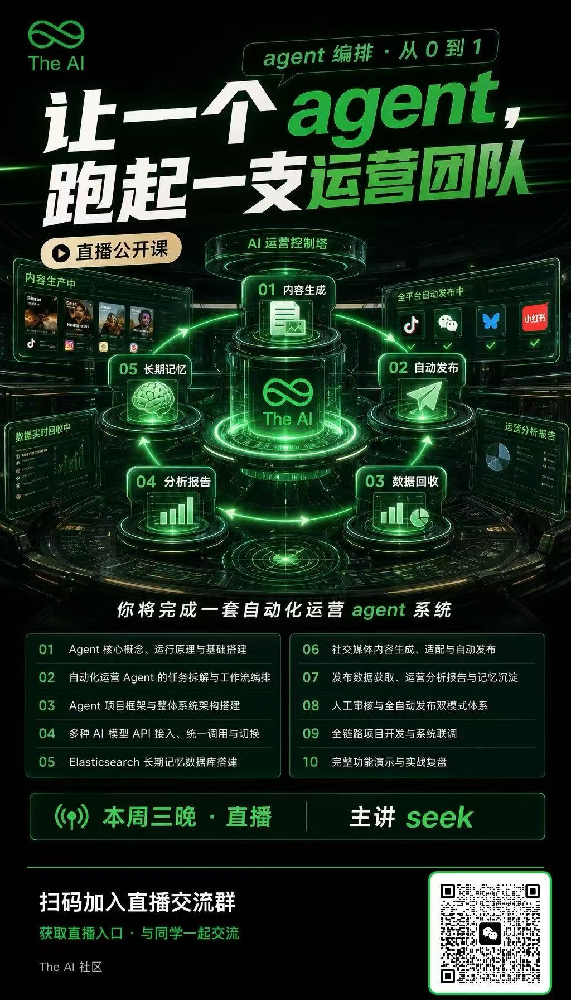

# 从 0 到 1 搭建 AI Agent 系列公开课

## 课程大纲

- Agent核心概念与基础搭建
- 自动化运营Agent 的任务拆解与工作流编排
- Agent 项目框架搭建
- 多种AI模型API接入、统一调用与切换
  - 不同类型文件处理的时候调度室不同模型
  - 根据费用如何去组合调度底层 AI 的大模型
- LevelDB 记忆数据库的搭建与设计
- 社交媒体的内容生成，适配和自动发布
- 运营反馈数据如何形成记忆数据（企业知识库的原理）
- 人工审核与全自动发布双模式体系
- 完成整个项目研发和 Demo 展示

## 课程的宣传图片

